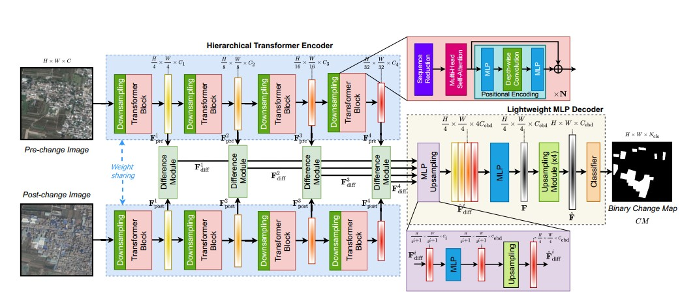
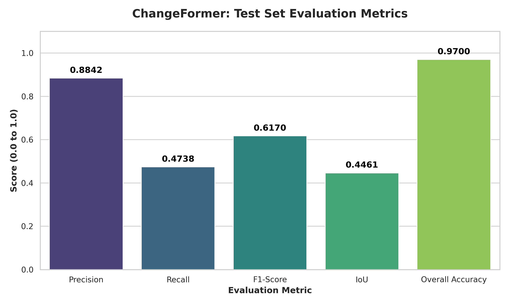
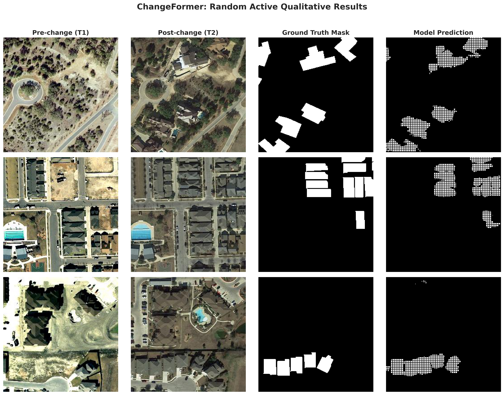

# ChangeFormer: Transformer-based Siamese Network for Change Detection

##  Project Overview & Research Context
This repository contains a highly optimized, from-scratch PyTorch implementation of the **ChangeFormer** architecture. The primary research objective of this project is to perform accurate binary Change Detection (CD) on co-registered bi-temporal remote sensing images. 

Traditionally, Change Detection heavily relied on deep Convolutional Neural Networks (ConvNets). However, ConvNets often struggle to capture the long-range spatial and temporal contextual dependencies required to distinguish relevant changes (e.g., new buildings) from irrelevant ones (e.g., seasonal variations, shadows). 

Through a detailed architectural study, this project eliminates the dependency on ConvNets. Instead, it utilizes a **Siamese Hierarchical Transformer Encoder** coupled with a **Lightweight MLP Decoder**. This approach drastically increases the effective receptive field, enabling the model to learn optimal distance metrics across multi-scale features seamlessly.

---

##  Architectural Survey & Intuition
The system processes two RGB images (Pre-change and Post-change) through three core modules:

1. **Hierarchical Transformer Encoder (Siamese Weight-Sharing):** 
   Extracts multi-scale features without CNN backbones. To solve the quadratic $O((HW)^2)$ complexity of standard self-attention, it employs a Sequence Reduction mechanism. Furthermore, a 3x3 depth-wise convolution within the Feed-Forward Network injects dynamic positional encodings, allowing the model to generalize across varying input resolutions.
   
2. **Multi-Scale Difference Modules:** 
   Instead of computing absolute differences, the network concatenates the extracted features from both temporal branches and learns the optimal distance metric via localized convolutions and ReLU activations.

3. **Lightweight MLP Decoder:** 
   A highly efficient decoder that aligns channel dimensions, bilinearly upsamples the feature maps, and fuses them through Linear (1x1 Conv) layers to output a robust binary change mask.

*(Below is the architectural diagram as proposed in the original ChangeFormer paper)*

---

## Dataset Preparation & Preprocessing
Properly structuring and preprocessing the data was critical for the success of this model. The project utilizes the **LEVIR-CD** dataset, which consists of ultra-high-resolution ($1024 \times 1024$) Google Earth images spanning over a period of 5 to 14 years.

To optimize the dataset for deep learning and fit within GPU memory constraints, a custom data pipeline was engineered:

* **Non-Overlapping Patch Extraction:** The original $1024 \times 1024$ images were systematically sliced into smaller $256 \times 256$ non-overlapping patches. This process exponentially increased the volume of training samples while maintaining spatial integrity.
* **Synchronized Bi-Temporal Augmentation:** Remote sensing models are highly sensitive to misalignments. Geometric transformations (Random Horizontal/Vertical Flips, Random Rotations, and Crops) were implemented with synchronized random seeds. This ensures that Image A (Time 1), Image B (Time 2), and the corresponding Label Mask are augmented identically, strictly preserving their spatial co-registration.
* **Zero-I/O RAM Caching:** To prevent severe CPU-to-GPU bottlenecks during training, a custom PyTorch Dataset class was developed. When `preload_to_ram=True` is activated, the entire dataset of sliced patches is cached directly into the system's RAM before training begins, completely eliminating disk-read latency during epoch iteration.
* **Class Imbalance Handling:** Since change detection datasets naturally suffer from extreme class imbalance (most pixels are "unchanged"), the preprocessing pipeline includes mechanisms to filter out completely empty patches during targeted evaluation to better assess the model's true positive capabilities.

---

##  Advanced Engineering & Optimization
In addition to data-level optimizations, several advanced engineering practices were integrated into the training loop:

* **Automatic Mixed Precision (AMP):** Utilized `torch.amp.GradScaler` to train the transformer blocks using half-precision (FP16), significantly reducing VRAM consumption and accelerating gradient computation without sacrificing model accuracy.
* **Gradient Clipping:** Implemented to stabilize the Multi-Head Self-Attention layers and prevent gradient explosion, a common issue when training deep transformers from scratch.

---

##  Quantitative Results
The model was trained on the processed LEVIR-CD patches using the AdamW optimizer (Learning Rate: 1e-4, Weight Decay: 0.01) with a Linear Decay Scheduler. Due to computational constraints, the model was trained for **30 epochs** (as opposed to 200 in the original literature), yet it achieved highly competitive performance.

**Test Set Evaluation Metrics:**
* **Overall Accuracy (OA):** 0.9700
* **Precision:** 0.8842
* **Recall:** 0.4738
* **F1-Score:** 0.6170
* **IoU:** 0.4461

---

##  Qualitative Inference & Visualizations
To evaluate the model's practical performance, an intelligent inference script was developed to filter and visualize only the patches containing active changes. 

Below are random samples from the Test Set displaying the Pre-change Image, Post-change Image, Ground Truth Mask, and the Model's Prediction. The model demonstrates a strong ability to map building footprints despite variations in illumination and angle.

---

##  Research Extensions & Future Directions
As part of ongoing research and exploration for graduate-level deployment, this repository sets the foundation for several advanced studies:

1. **Ablation Studies on Sequence Reduction:** Investigating how tuning the Reduction Ratios ($R$) across the 4 transformer stages impacts the F1-Score versus VRAM consumption.
2. **Domain Alignment for Autonomous Navigation:** Adapting the Siamese Transformer backbone to process real-time Synthetic Aperture Radar (SAR) and RGB feeds for drone routing and visual terrain matching in defense applications.
3. **Failure Case Analysis:** Systematically categorizing False Positives (e.g., seasonal vegetation shifts vs. architectural changes) to introduce targeted loss penalties (such as boundary-aware Dice Loss) for highly imbalanced datasets.

---